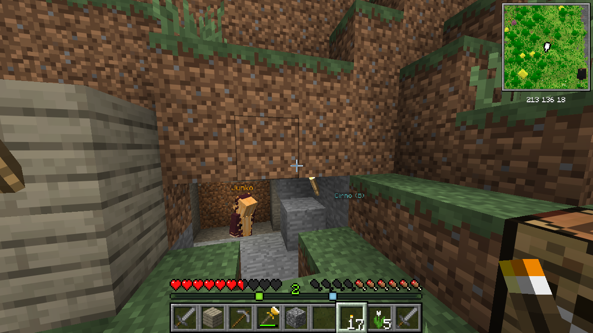

# Minimap (Horizon native mod)

Horizon's official Minimap: a map of the terrain around you in a corner, in map colours, square or round, north up or turning with you, drawn by Horizon's own minimap. Its settings page (Options > Mods > Minimap > Settings) picks the corner, size, shape, zoom, turning, coordinates and outline style.

It is a [horizon-mixins](https://github.com/horizon-rust/horizon-mixins) bundle (`mixins/minimap/`) that the Horizon
launcher builds into the game. It keeps the settings of earlier versions: the same files (`horizon-mods/.horizon-mod-data/minimap/corner`, `size`, `shape`, `zoom`, `rotate`).

## Install

In the Horizon launcher: Mods → Minimap → Install, then **Build** on the same page (once built, switch it
on or off in the game under Options → Mods). The
launcher downloads its own Rust and builds the game with your native mods; see Horizon's
[native mods](https://github.com/horizon-rust/horizon/blob/main/docs/native-mods.md).

## Made on the hook points

The bundle uses Horizon's native hook points (`crates/horizon-client/src/game/native_hooks.rs`), which keep
their names and signatures across releases. `compatibility.json` records the required native API baseline (`"hooks": 359`) and the tested Horizon revision. The outline and coordinate drawing also inject into the internal HUD renderer, so they depend on its `draw_minimap` function and corner layout; the checks below verify that integration on the tested revision and newest Nightly.

| File | What it is |
|---|---|
| `mixins/minimap/horizon-mixin.toml` | The bundle: settings/game hooks and minimap HUD drawing injections |
| `mixins/minimap/runtime.rs` | The mod's logic and state, added to the game as `game::official_minimap`; also this crate's library, for its tests |
| `mixins/minimap/*.rs` | One small helper per hook |
| `../tools/native.py` | Shared by the native mods: apply on Horizon (from GitHub, by commit), check, build, package the `.hnmod`, run the proof |
| `proof.py` (with `../tools/game.py`) | The proof: the built game driven with `horizon-ctl --offscreen` on fresh, temporary data |

## Build and prove

```sh
(cd native/minimap && cargo test)                    # the logic
python3 native/tools/native.py check minimap       # apply on the tested Horizon and cargo check the game
python3 native/tools/native.py check minimap --horizon latest  # ... on the newest Nightly
python3 native/tools/native.py check all           # with the other native mods, as a player's set
python3 native/tools/native.py package minimap     # native/target/minimap-<version>.hnmod for the registry
python3 native/tools/native.py proof minimap --resources /path/to/.local/horizon-client/26.3
```

The proof needs resources prepared from your own Minecraft 26.3 (`horizon-prepare`); none are in this repository.
It seeds an earlier version's settings (bottom right, round, 2 blocks per pixel) in a temporary game folder, then checks that Options > Mods shows them, and that the Corner button moves the map to the top left and writes the same file. CI runs `cargo test`, packages the `.hnmod` and checks the game on the tested commit, and every Monday on the newest Nightly.

License: MIT.

## Outline styles and coordinates

**Minimap Outline** cycles through Black (the existing frame), Stone (a textured grey bevel with mineral flecks and a black outer edge), and Bamboo (a textured beige frame). Stone and Bamboo draw four half-GUI-pixel bands inside the map's existing bounds, for square and round maps in every corner.

Enable **Show Coordinates** to display the player's floored `X Y Z` block position, including negative coordinates. The text is centered below the map, white with a shadow and no background box. HUD layout reserves space for the strip in every corner so it does not overlap adjacent widgets.

Existing defaults stay the same: top right, medium, square, one block per pixel, north up, and a black outline. Coordinates are off by default. Saved preferences are respected; the new values persist as `outline` and `show_coordinates` alongside the existing settings.

The game hook supplies position and style state. Two additional injections around `extras_hud::draw_minimap` reserve the coordinate strip and draw it and the optional outline; these internal rendering injections also depend on Horizon's HUD layout, beyond the stable native hook point used for the map itself.



Screenshot supplied by eltanschauung. It shows the Stone outline and coordinates enabled; those are optional settings, and the other mods visible in the scene are separate from this change.
